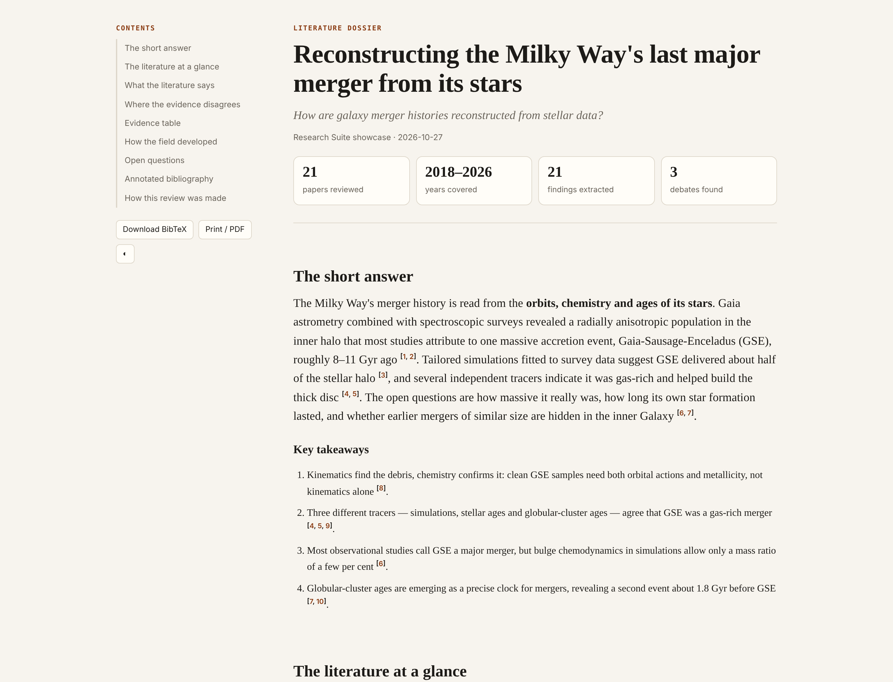
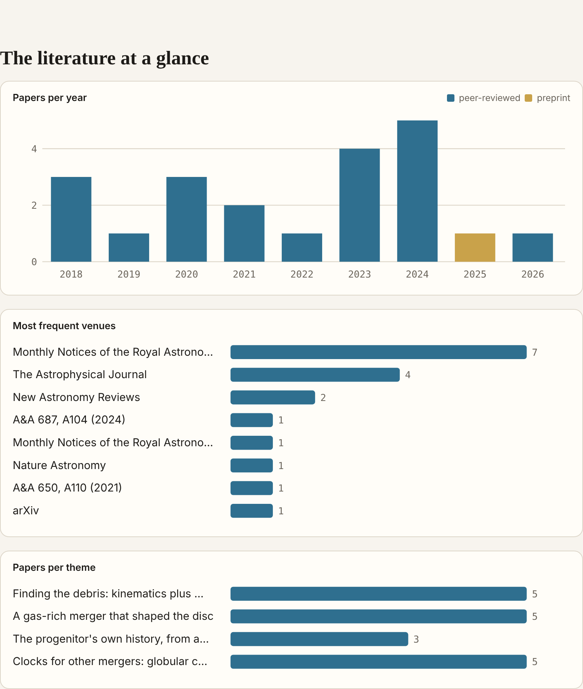
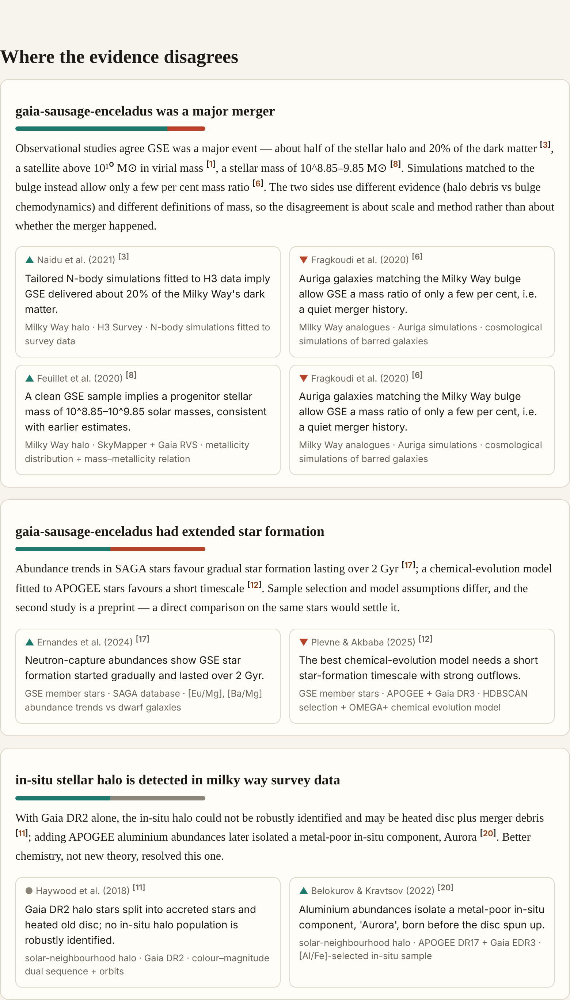
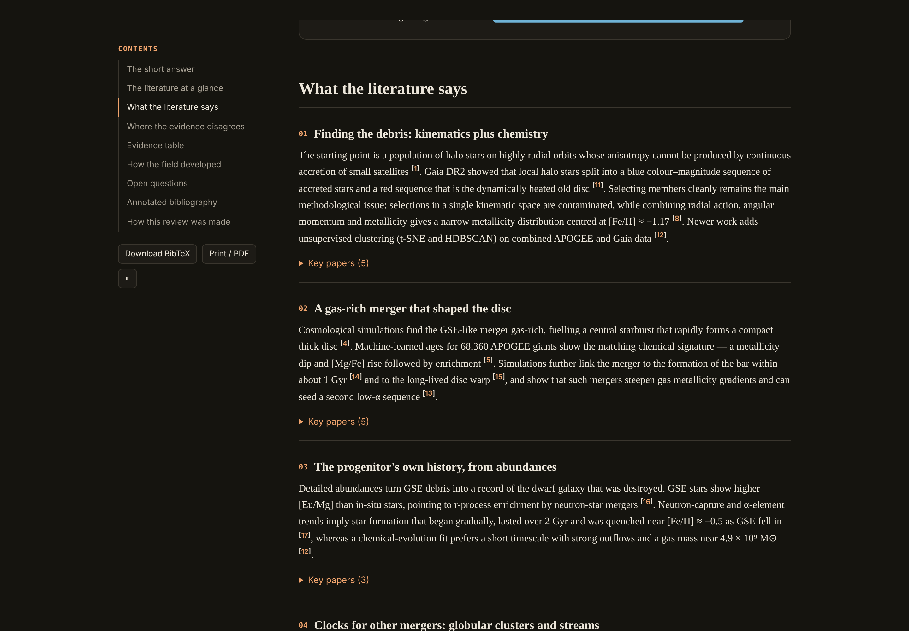
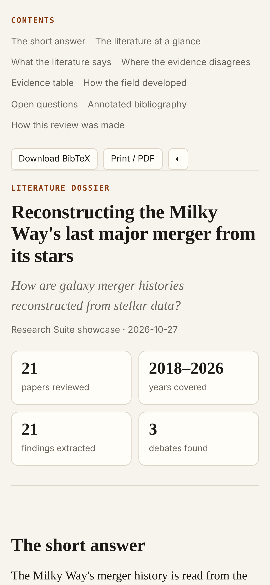

# Research Dossier

Turn a set of papers into a documented, visual, citation-checked literature review.

A free, open-source [agent skill](https://www.agensi.io/learn/skill-md-format) (SKILL.md) for students and researchers. Works with Claude Code, Codex CLI, Cursor, Gemini CLI and any agent that supports the SKILL.md standard.

## Screenshots



| Charts: papers per year, venues, themes | Debates with the claims side by side |
|---|---|
|  |  |
| **Themes (dark mode)** | **Mobile** |
|  |  |

*Real output, not a mock-up:* a run on the question **“How are galaxy merger histories reconstructed from stellar data?”** (OpenAlex + arXiv, 114 papers). The files are in [`examples/milky-way-mergers/`](examples/milky-way-mergers/) — download `dossier.html` and open it in a browser.

## What it does

The agent writes the synthesis (answer, takeaways, themes, debates, open questions, annotations) into `synthesis.json`, citing papers only as `[@key]`. `scripts/dossier.py` then:

- **checks every citation** against `papers.json` and refuses to build if any is unknown or hand-typed,
- numbers citations in reading order and builds an APA-style annotated bibliography,
- draws charts (papers per year with preprints marked, top venues, papers per theme) as inline SVG,
- adds the debates and evidence table from [claim-conflict-finder](https://github.com/AppleBoiy/claim-conflict-finder) when present,
- records the search strings, sources, screening counts and excluded papers so the review is reproducible.

## Outputs

| File | Use it for |
|---|---|
| `dossier.html` | The report: one offline file, light/dark, table of contents, prints cleanly to PDF, "Download BibTeX" button |
| `dossier.md` | Numbered citations + reference list, paste into Word or Google Docs |
| `dossier.pandoc.md` | `[@key]` citations: `pandoc dossier.pandoc.md --citeproc -o review.docx` in any citation style |
| `references.bib` | Every cited and included paper |

```bash
python3 scripts/dossier.py check --out research/<slug>
python3 scripts/dossier.py build --out research/<slug>
```

## Network

None. Reads and writes only inside the `--out` folder.

## Part of the Research Suite

Three free, open-source agent skills that chain through one shared data format ([`references/schema.md`](references/schema.md)):

| Step | Skill | What it does |
|---|---|---|
| 1 |  [paper-scout](https://github.com/AppleBoiy/paper-scout) | Finds real papers, ranks them, draws a citation map, writes BibTeX |
| 2 |  [claim-conflict-finder](https://github.com/AppleBoiy/claim-conflict-finder) | Extracts findings as claims and shows where and why papers disagree |
| 3 |  [research-dossier](https://github.com/AppleBoiy/research-dossier) | Writes a visual, citation-checked literature review |

Each skill also works on its own.

## Install

**Any agent through Agensi** — search for `research-dossier` on [agensi.io](https://www.agensi.io) and add it (free).

**Claude Code**

```bash
git clone https://github.com/AppleBoiy/research-dossier.git ~/.claude/skills/research-dossier
```

**Other SKILL.md agents** (Codex CLI, Cursor, Gemini CLI, …) — clone the repo into the agent's skills folder. The agent reads `SKILL.md`; the scripts need Python 3.10+ and nothing else.

Then just ask, e.g. *"Write a 1,500-word literature review from my research folder for my thesis proposal."*

## Development

```bash
python3 -m unittest discover -s tests -v   # offline tests, no network needed
python3 tools/package.py                    # builds dist/research-dossier.zip for Agensi (templates embedded into the script)
```

`assets/` holds the HTML template(s); `scripts/` loads them from there during development, and the packaged zip embeds them so the script runs as a single file.

## License

MIT © [Chaipat Jainan](https://www.chaipat.cc). Issues and pull requests welcome.
